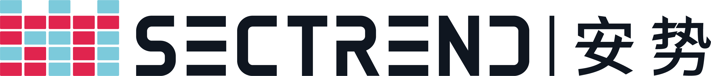

  

<h1 align="center">Sectrend</h1>

Software supply chain security for the AI era.

  We help teams see and govern risk across source code, open-source components, binaries, and AI agents.

  <a href="https://www.sectrend.com.cn">sectrend.com.cn</a>

## What we build

- **CleanCode** — AI code security agent
- **CleanSource SCA** — software composition analysis & open-source compliance
- **SkillSec** — security and capability audit for AI agent skills
- **CleanBinary** — binary composition analysis
- **PureStream** — governance for model and agent workflows

## Contact

[Website](https://www.sectrend.com.cn) · [info@sectrend.com.cn](mailto:info@sectrend.com.cn)
