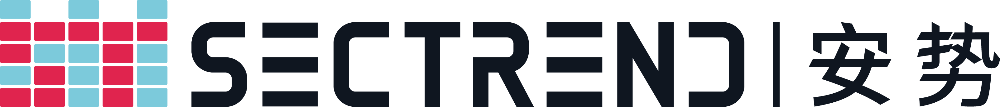

  <picture>
    <source media="(prefers-color-scheme: dark)" srcset="logo-dark.png" />
    
  </picture>

<h3 align="center">From Vibe to Value</h3>

从灵感到价值

  We help teams see and govern risk across source code, open-source components, binaries, and AI agents.

  
  

---

## What we build

| Layer | Product | What it does |
| --- | --- | --- |
| Source code | **CleanCode** | AI code security agent |
| Open-source components | **CleanSource SCA** | Software composition analysis and open-source compliance |
| Binaries | **CleanBinary** | Binary composition analysis |
| AI agents | **SkillSec** | Security and capability audit for AI agent skills |
| AI agents | **PureStream** | Governance for model and agent workflows |
| Engineering quality | [**Pluvy**](https://github.com/sectrend-cn/pluvy) | Engineering policy gate for code written by people and coding agents |

## Get in touch

Questions, trials, or partnerships: visit [sectrend.com.cn](https://www.sectrend.com.cn) or email [info@sectrend.com.cn](mailto:info@sectrend.com.cn).
